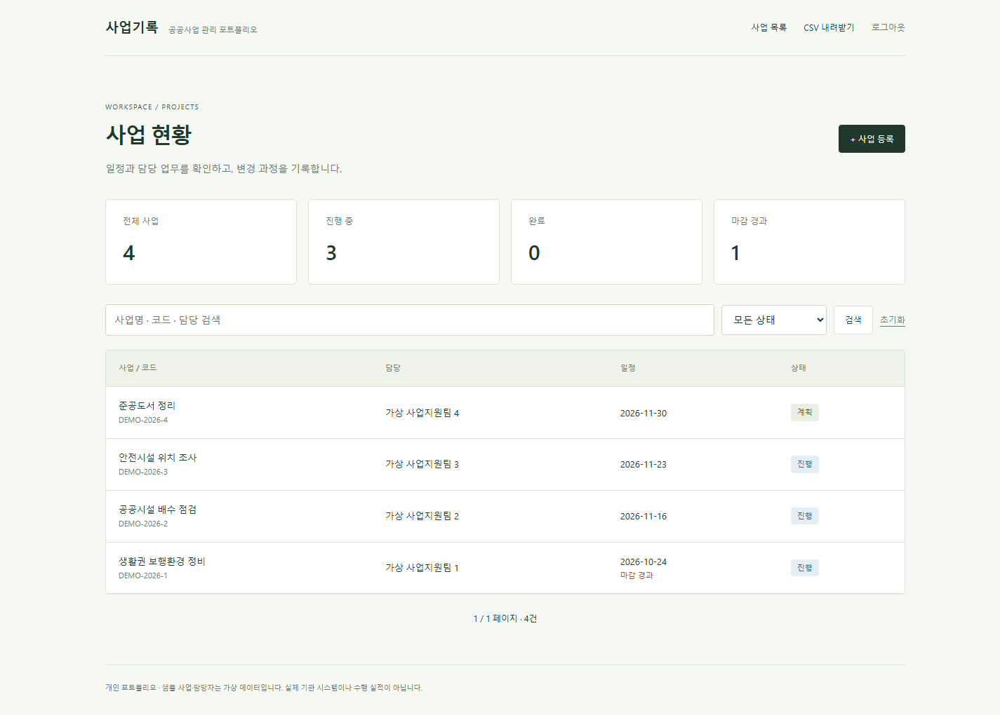
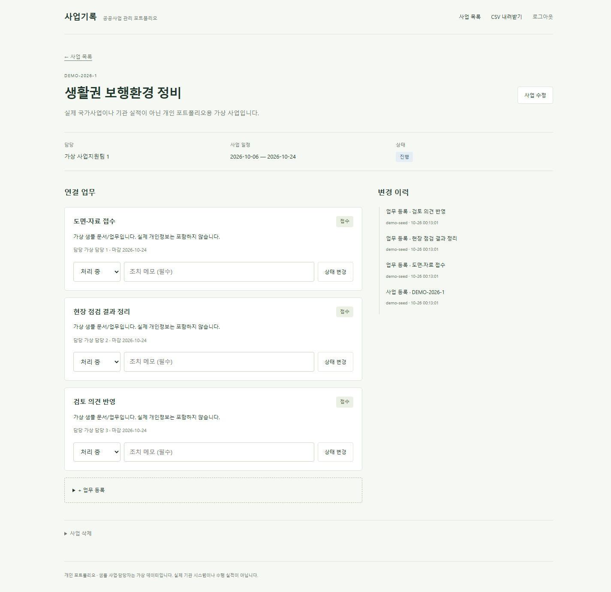
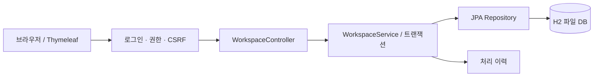
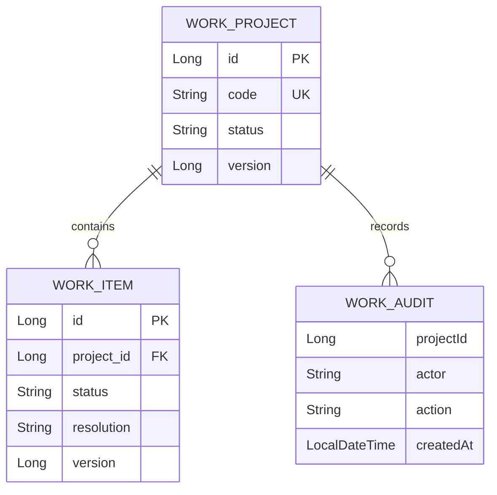

# 사업·업무 관리 시스템

사업 담당자가 진행 현황과 처리 이력을 한 화면에서 관리하는 Spring 웹 애플리케이션입니다. 사업 등록부터 업무 접수, 조치 메모, 완료 처리, CSV 인계까지 이어지는 흐름을 구현했습니다.

공공 시설 유지관리 업무를 가정한 개인 프로젝트입니다. 화면의 사업명·담당자·업무는 시연용 가상 데이터입니다.



## 실행

Java 21과 인터넷 연결이 필요합니다. Maven은 Wrapper가 준비합니다. 저장소 루트에서 실행합니다.

```powershell
.\mvnw.cmd spring-boot:run
```

macOS / Linux에서는 `bash mvnw spring-boot:run`을 사용합니다. 브라우저에서 **http://127.0.0.1:8080/** 에 접속합니다.

| 시연 계정 | 비밀번호 | 권한 |
|---|---|---|
| `editor` | `Portfolio-2026!` | 조회·등록·수정·삭제·업무 처리·CSV |
| `viewer` | `View-2026!` | 조회·검색·CSV |

기본값은 로컬 시연용입니다. `APP_EDITOR_PASSWORD`, `APP_VIEWER_PASSWORD`로 바꿀 수 있습니다. 서버는 기본적으로 `127.0.0.1`에 바인딩됩니다.

첫 실행에 사업 4개와 업무 12개를 등록합니다. 데이터는 `data/portfolio.mv.db`에 보존되며 다음 실행에서 초기화되지 않습니다. 테스트는 별도 인메모리 DB를 사용합니다. DB 파일은 Git에서 제외합니다.

## 주요 기능

| 업무 | 구현 내용 |
|---|---|
| 사업 관리 | 고유 사업 코드, 사업명, 담당, 기간, 상태 등록·조회·수정·삭제 |
| 현황 조회 | 전체·진행·완료·기한 초과 집계, 키워드·상태 검색, 10개 단위 페이지 |
| 업무 처리 | 사업별 업무 등록, 담당자·마감일, 상태 전이와 필수 조치 메모 |
| 변경 추적 | 처리자·시각·변경 내용이 남는 이력 |
| 자료 인계 | UTF-8 BOM CSV, 따옴표·개행 처리, 수식 시작 문자 보호 |
| 접근 제어 | 세션 로그인, 조회·편집 권한 분리, CSRF 토큰, 서버 측 검증 |
| 동시 수정 | JPA `@Version`과 제출 버전 비교로 오래된 수정 요청 거절 |



## 5분 시연

1. `editor`로 로그인해 `사업 등록`에서 새 사업을 만듭니다.
2. 상세 화면에서 담당자와 마감일을 지정해 업무를 등록합니다.
3. 업무를 **접수 → 처리 중 → 처리 완료**로 변경하며 조치 메모를 남깁니다.
4. 미완료 업무가 있는 사업을 완료하려 하면 거절되는 것을 확인합니다.
5. 같은 수정 화면을 두 탭으로 열어 한쪽 저장 후 다른 쪽을 저장하면 충돌을 안내합니다.
6. 로그아웃 후 `viewer`로 로그인하면 편집 버튼이 사라집니다. 직접 POST 요청도 서버에서 403으로 차단합니다.

완료 업무는 처리 중으로 재개할 수 있습니다. 완료 사업의 업무를 바꾸려면 먼저 사업 상태를 변경해야 합니다. 업무가 연결된 사업 삭제는 거절합니다.

## 구조와 설계

Java 21 · Spring Boot 4.1.2 · Spring MVC · Spring Security · Spring Data JPA · Bean Validation · Thymeleaf · H2 · Maven





이력의 `projectId`는 삭제 후 기록을 보존하기 위한 논리 참조입니다. 서비스가 업무 규칙과 트랜잭션을 맡고, 컨트롤러는 입력 검증과 화면 전환을 담당합니다. 검색의 `%`, `_`는 와일드카드가 아닌 문자로 처리합니다. 화면에는 Thymeleaf 이스케이프를 적용합니다.

H2 파일 DB와 서버 렌더링을 선택해 외부 DB나 프런트엔드 빌드 없이 실행할 수 있게 했습니다. 로그인 사용자는 메모리 기반의 두 시연 계정입니다.

## 검증

```powershell
.\mvnw.cmd test
.\mvnw.cmd package
java -jar target/portfolio-spr-0.0.1-SNAPSHOT.jar
```

2026-10-26 Windows / Java 21에서 **32개 테스트 통과**, 실행 JAR 패키징과 실행을 확인했습니다. 실제 HTTP로 등록한 사업이 JAR 재시작 후에도 유지되는 것을 확인하고 검증용 사업은 삭제했습니다. 신규 사업 관리 테스트 19개와 기존 모듈 테스트 13개입니다.

- 실제 로그인, CSRF 누락, 조회 계정의 쓰기 거절
- 사업 CRUD, 중복 코드, 기간 오류, 검색, HTML 이스케이프
- 업무 상태 순서, 타 사업의 업무 접근, 조치 메모, 완료·삭제 제약
- 오래된 버전 충돌, CSV BOM·인용·수식 보호

실행 중인 서버를 대상으로 Chrome에서 **13개 화면 검사**를 통과했습니다. 1440px / 390px에서 현황·등록·상세·검색·조회 권한과 가로 넘침을 확인했습니다. 이미지는 실제 실행 화면입니다.

```powershell
powershell -ExecutionPolicy Bypass -File scripts/test-browser.ps1
```

브라우저 검사는 기본 시연 데이터와 기본 비밀번호를 기준으로 합니다. [GitHub Actions 설정 템플릿](docs/ci/verify.yml)은 Java 테스트를 실행하도록 작성했습니다. 현재 연결된 토큰에는 `workflow` 권한이 없어 `.github/workflows/` 등록은 제외했습니다.

## 주요 코드

- [업무 규칙과 트랜잭션](src/main/java/com/youns/portfoliospr/workspace/WorkspaceService.java)
- [로그인·권한 정책](src/main/java/com/youns/portfoliospr/workspace/WorkspaceSecurity.java)
- [화면 컨트롤러](src/main/java/com/youns/portfoliospr/workspace/WorkspaceController.java)
- [통합 테스트](src/test/java/com/youns/portfoliospr/WorkspaceTests.java)
- [실행 검증 기록](docs/verification.md)

## 적용 범위

가상 사업의 업무 처리를 끝까지 실행하는 로컬 포트폴리오입니다. 실제 기관의 업무 규정·보안 인증·전자결재·첨부파일 관리·외부 시스템 연계는 포함하지 않습니다. 운영 배포에는 사용자 관리, HTTPS, 비밀값 관리, DB 마이그레이션·백업, 감사로그 접근 통제, 부하·동시성 검증을 별도로 설계해야 합니다.

기존 익명 커뮤니티 코드는 `/community` 경로에 보존했습니다. 해당 모듈은 게시글별 비밀번호를 사용하는 별도 학습 코드이며 `/workspace/**` 로그인 정책의 적용 대상이 아닙니다. [기존 모듈 설명](docs/legacy-community.md)
